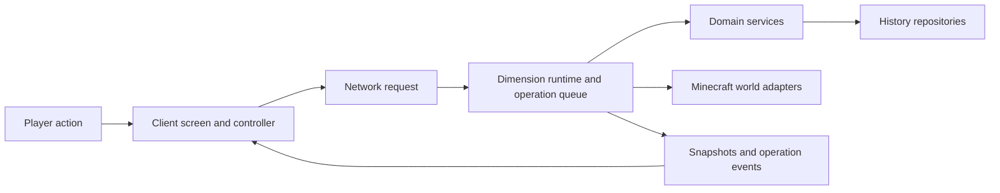

# Project map

[Documentation home](README.md) / Project map

## The model in one page

Lumi runs inside Minecraft through Fabric.
Its client shows screens and sends requests.
Its server validates requests, reads the world, and owns history operations.
Singleplayer uses an integrated server with the same history rules as a dedicated server.

The server gives each loaded dimension its own runtime and history repository.
Each dimension has one physical world and one active workspace and branch.
A player cannot keep a private live branch in that same dimension.



This diagram shows the runtime flow.
It does not mean that every class calls every other layer.
Follow the [workflows](workflows.md) for the actual collaborators.

## Terms you will meet

| Term | Meaning in Lumi |
| --- | --- |
| Dimension | A Minecraft world space, such as the Overworld. Each has separate Lumi history. |
| Workspace | A named project scope with settings and optional bounds over the shared dimension. |
| Zone | A workspace scope made from 16-by-16-by-16 section cells. Zones can overlap. |
| Version or commit | An immutable saved record that names a world-state tree, parents, author, and other metadata. |
| Branch | A named reference to a commit. Switching it changes the dimension's canonical live state. |
| HEAD | The commit named by the active branch reference. |
| Reference or ref | A persisted name that points to a commit. It has a revision for conflict checks. |
| Ref revision | A counter used to reject requests based on an outdated branch reference. |
| Ref-neutral | An operation that leaves the branch reference unchanged. |
| Section | A 16-by-16-by-16 block volume inside a chunk. |
| Entity chunk | The durable non-player entity state associated with a chunk. |
| Origin | A history key's original state, used when a sparse commit tree has no explicit leaf. |
| Working index | Dirty history keys and their generation counters. It tracks work that a Save may need. |
| Generation | A change boundary. Clearing a captured generation must preserve newer edits. |
| Freeze | A dimension-wide mutation barrier held during an exact capture or destructive operation. |
| Operation journal | A durable record that lets recovery identify an interrupted operation and its phase. |
| Merkle tree | A tree whose nodes have content hashes. Equal hashes let Compare skip unchanged regions. |
| Checkpoint | A hidden saved return point used by an operation or session Undo. |
| Publication | The durable change that makes a prepared result visible through refs or pointers. |

## Find the right package

All production packages below start at `src/main/java/io/github/lumi/`.

| Package | Owns | First useful class |
| --- | --- | --- |
| `domain/model` | Valid values, persisted records, summaries, and focused runtime state | [VersionDisplayName](../../src/main/java/io/github/lumi/domain/model/VersionDisplayName.java) |
| `domain/service` | Save, Restore, Compare, branches, workspaces, zones, and permissions | [SaveService](../../src/main/java/io/github/lumi/domain/service/SaveService.java) |
| `storage/object` | Binary world payloads, hashes, compression, and immutable packs | [ObjectStore](../../src/main/java/io/github/lumi/storage/object/ObjectStore.java) |
| `storage/repository` | File paths, refs, journals, and persisted metadata | [WorldObjectRepository](../../src/main/java/io/github/lumi/storage/repository/WorldObjectRepository.java) |
| `storage/packageformat` | Portable package encoding and validation | [LumiPackageManifestCodec](../../src/main/java/io/github/lumi/storage/packageformat/LumiPackageManifestCodec.java) |
| `minecraft/runtime` | Server lifecycle and assembly of dimension workflows | [FabricDimensionRuntime](../../src/main/java/io/github/lumi/minecraft/runtime/FabricDimensionRuntime.java) |
| `minecraft/operation` | Queues, freezes, incremental phases, and terminal outcomes | [DimensionOperationCoordinator](../../src/main/java/io/github/lumi/minecraft/operation/DimensionOperationCoordinator.java) |
| `minecraft/world` | World capture, decoded apply, durability, and exact verification | [MinecraftWorldStateApply](../../src/main/java/io/github/lumi/minecraft/world/MinecraftWorldStateApply.java) |
| `mixin` | Hooks into Minecraft and optional builder tools | [LumiMixinPlugin](../../src/main/java/io/github/lumi/mixin/LumiMixinPlugin.java) |
| `network` | Immutable payloads and server request handlers | [LumiServerNetworking](../../src/main/java/io/github/lumi/network/LumiServerNetworking.java) |
| `client` | Client assembly, networking, input, and world overlays | [LumiClient](../../src/main/java/io/github/lumi/client/LumiClient.java) |
| `client/state` | Correlated client snapshots and query results | [ClientHistoryStore](../../src/main/java/io/github/lumi/client/state/ClientHistoryStore.java) |
| `client/ui` | Screens, small controllers, layouts, and view state | [SaveScreenController](../../src/main/java/io/github/lumi/client/ui/SaveScreenController.java) |
| `client/preview` | Optional Save thumbnails and texture access | [ClientVersionPreviewStore](../../src/main/java/io/github/lumi/client/preview/ClientVersionPreviewStore.java) |
| `telemetry` | Bounded diagnostic data and its sender | [TelemetryService](../../src/main/java/io/github/lumi/telemetry/TelemetryService.java) |
| `update` | Release checks and manifest validation | [UpdateChecker](../../src/main/java/io/github/lumi/update/UpdateChecker.java) |

## Entry points and lifecycle

[fabric.mod.json](../../src/main/resources/fabric.mod.json) declares two entry points:

- [LumiMod.onInitialize](../../src/main/java/io/github/lumi/LumiMod.java) registers server lifecycle hooks, networking, and commands.
- [LumiClient.onInitializeClient](../../src/main/java/io/github/lumi/client/LumiClient.java) connects client stores, screens, hotkeys, and overlays.

[LumiServerRuntime](../../src/main/java/io/github/lumi/minecraft/runtime/LumiServerRuntime.java) connects Fabric events to the server session.
[FabricServerSession](../../src/main/java/io/github/lumi/minecraft/runtime/FabricServerSession.java) owns the server's workers and dimension runtimes.
[FabricDimensionRuntime](../../src/main/java/io/github/lumi/minecraft/runtime/FabricDimensionRuntime.java) connects one dimension's services and operations.

These assembly classes contain many collaborators.
Use the named workflow method to enter them, such as `startSave` or `startRestore`.
Read the called service and matching test before you study the full assembly class.

## Threads and operation ownership

| Place | Appropriate work |
| --- | --- |
| Server tick | Minecraft world access, activation checks, frozen capture, and bounded prepared apply steps |
| Server background workers | History I/O, comparison, decoding, Restore preparation, and durability work through explicit adapters |
| Client thread | Screens, client stores, and accepted network result coordination |
| Render thread | GPU upload, drawing, and release of render resources |
| Client background workers | Immutable overlay geometry and optional preview preparation |

Do not access a live Minecraft world from a worker just because a service uses a future.
Use the existing adapter contract for that specific operation.

[DimensionOperationCoordinator](../../src/main/java/io/github/lumi/minecraft/operation/DimensionOperationCoordinator.java) owns queued and active mutations.
A queued request must revalidate permission, expected refs, and scope revisions when it activates.
A disconnect discards client-owned queued work.
After world mutation starts, the server must finish or recover the journaled apply.

## Rules that changes must preserve

1. Save must match its exact visible capture boundary.
2. Restore must restore blocks, block entities, and durable entities without hidden residue.
3. An interrupted operation must preserve previously valid history.
4. Save must clear only the captured generation boundary after publication.
5. Destructive operations must retain the dimension freeze through exact durable verification.
6. One dimension must have at most one mutating history operation.
7. Zone actor membership must not become permission to perform server actions.
8. Heavy history preparation must stay outside the server tick.
9. Tick-time apply must use decoded state, without JSON parsing, LZ4 decompression, or block-state decoding.
10. Long operations must report progress and limit memory to current work batches.
11. Completed operations must leave ordinary usable Minecraft world data.

An interrupted Restore requires Lumi until recovery finishes.
Idle play must avoid history work when Lumi has nothing useful to do.
See [Storage and recovery](storage.md) for publication order and [Testing](testing.md) for the relevant gates.

## Find tests and resources

- Unit tests mirror production packages under [src/test/java](../../src/test/java).
- Minecraft acceptance tests live under [src/gametest](../../src/gametest).
- Translations, mixin registration, and mod metadata live under [src/main/resources](../../src/main/resources).
- The Gradle wrapper and [build.gradle](../../build.gradle) define the supported build tasks.

Use a targeted search when you know a feature or class name:

```powershell
rg -n 'startSave|createChunkReadySave' src/main/java/io/github/lumi/minecraft/runtime/FabricDimensionRuntime.java
rg --files src/test/java -g '*Save*Test.java'
```

`rg` is an optional search tool.
Your IDE's symbol search and Find Usages can answer the same questions.
